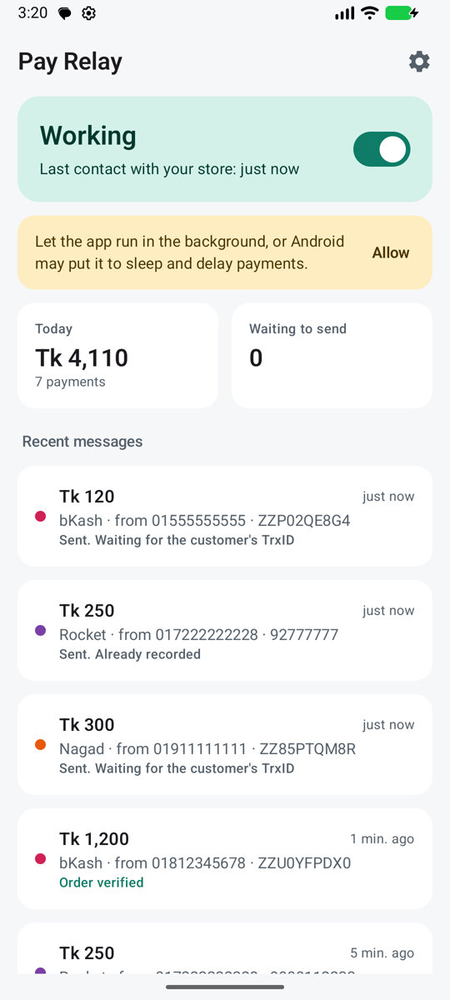

<div align="center">


# Pay Relay

**Turn the phone that holds your bKash, Nagad or Rocket SIM into an automatic payment checker for your online store.**

When a customer pays, the wallet sends your phone a "money received" SMS. Pay Relay passes that message to your store's server within seconds, and the store matches it to the order by its TrxID. No manual checking, no third-party SMS forwarder, no extra servers in between.

[](https://github.com/SahinurDEV/pay-relay/actions/workflows/build.yml)
[](LICENSE)


[Download the latest APK](https://github.com/SahinurDEV/pay-relay/releases/latest) · [Set it up](#set-it-up) · [Server API](#server-api) · [বাংলা](#বাংলায়-সংক্ষেপে)




</div>

## Why

Small shops in Bangladesh take payments with personal or merchant wallets. Checking every TrxID by hand is slow, and generic SMS-forwarding apps send **all** your messages (bank codes, private chats) to someone else's server. Pay Relay is built for this one job:

- **Only wallet messages.** It reads SMS from the wallets' own sender IDs (`bKash`, `NAGAD`, `16216`/Rocket) and nothing else. A customer cannot fake a payment by texting the phone from a normal number.
- **Codes never leave the phone.** OTP, PIN and verification messages are dropped even when they come from a wallet.
- **Straight to your server.** Messages go to the address you set, over HTTPS, and nowhere else. No ads, no analytics, no accounts.
- **Nothing is lost.** Every message waits in a queue on the phone until your server confirms it. No internet? It sends when the connection is back. Phone restarted, or the app was stopped? It picks up missed messages from the inbox.
- **You can see it working.** Today's total, what is waiting, and what your store did with each payment (verified, waiting for the customer's TrxID, amount mismatch). If the store stops answering, you get a notification.

## How it works

```
Customer pays ──► Wallet SMS ──► Pay Relay on your phone ──HTTPS──► Your store
                  "You have       filters: wallet sender,           POST /api/payments/sms
                   received        not a code, "received"            matches TrxID + amount
                   Tk 1,490..."    queues until confirmed            verifies the order
```

## Set it up

1. **On your server**, set a long random secret, for example `SMS_WEBHOOK_SECRET` for a [3lx](https://3lx.org) store. Generate one with `openssl rand -hex 32`.
2. **On the phone** with the wallet SIM, install the APK from [Releases](https://github.com/SahinurDEV/pay-relay/releases/latest).
3. Open Pay Relay, tap **Connect**, enter your store address (for example `https://your-store.com/api/payments/sms`) and the secret, then **Test and save**. The app checks that your store accepts the key before it saves anything.
4. Tap **Allow SMS access**, then allow notifications and background running when asked.

That's it. The status card says **Working** and shows the last contact with your store.

### Keep it reliable

- Use a phone that stays on charge and online (Wi-Fi or data).
- Allow background running. On Xiaomi, Oppo, Vivo, Realme, Samsung and similar phones also turn on **Autostart** and set battery to **No restrictions** for Pay Relay in the system settings. See [dontkillmyapp.com](https://dontkillmyapp.com) for your brand.
- Do not "force stop" the app. If it was stopped, opening it once picks up the missed messages.

## Server API

Pay Relay works with any server that accepts this request. It is the same one the 3lx store uses.

```http
POST /api/payments/sms
Authorization: Bearer <your secret>
Content-Type: application/json

{ "from": "bKash", "text": "You have received Tk 1,490.00 from 01711111111. ... TrxID CKA1B2C3D4 at 24/11/2026 16:45", "receivedAt": 1795517100000 }
```

| Answer | Meaning to the app |
| --- | --- |
| `2xx` with `{ "ok": true, "result": "verified" }` | Taken. `result` is shown next to the payment (`verified`, `no_order`, `mismatch`, `already_used`…). |
| `2xx` with `{ "ok": true, "ignored": true }` | Taken, not a payment message. The app's connection check uses this. |
| `401` / `403` | Wrong key. Sending stops and you get a notification until it is fixed. |
| `400` | This message will never be accepted. It is marked "Not sent" and can be retried by hand. |
| anything else, or no answer | Tried again later with back-off. |

Every 15 minutes the app sends `{ "from": "PayRelay", "text": "ping" }` so your server can show that the phone is online. Ignore it if you don't need it.

## Build it yourself

Requirements: JDK 17 or newer and the Android SDK (API 37). Android Studio has both.

```bash
git clone https://github.com/SahinurDEV/pay-relay.git
cd pay-relay
./gradlew testDebugUnitTest   # unit tests
./gradlew assembleDebug        # app/build/outputs/apk/debug/app-debug.apk
```

For a signed release, put a `keystore.properties` next to `settings.gradle.kts` (it is git-ignored):

```properties
storeFile=release.jks
storePassword=...
keyAlias=payrelay
keyPassword=...
```

then run `./gradlew assembleRelease`.

Debug builds can also talk to a server on your computer (`http://10.0.2.2:3000` from the emulator) and include a developer helper, described in [`DebugSetupReceiver.kt`](app/src/debug/java/org/threelx/payrelay/DebugSetupReceiver.kt). Test an incoming SMS on the emulator with:

```bash
adb emu sms send bKash "You have received Tk 10.00 from 01700000000. Fee Tk 0.00. Balance Tk 10.00. TrxID TEST123456 at 26/11/2026 10:00"
```

### Project layout

| Path | What it does |
| --- | --- |
| `sms/WalletFilter.kt` | Decides which messages may leave the phone. Covered by unit tests. |
| `sms/SmsReceiver.kt` | Receives each SMS from Android and drops anything not from a wallet. |
| `sms/Relay.kt` | Queue, sending, inbox catch-up, heartbeat and problem notifications. |
| `net/GatewayClient.kt` | The HTTP call to your server and what each answer means. |
| `data/` | Room database for the queue, settings with the key encrypted by the Android Keystore. |
| `work/` | WorkManager jobs: send now when online, retry with back-off, 15-minute heartbeat, restart after boot. |
| `ui/` | Jetpack Compose screens, English and Bangla. |

## Privacy

- SMS from any sender other than the wallets is not read past the sender ID, not stored and not sent.
- Wallet messages are stored only on the phone (kept 30 days after they were delivered) and sent only to the address you enter.
- The key is encrypted with a key held in the phone's Android Keystore. App data is excluded from cloud backups.
- No analytics, crash reporting or advertising libraries. The only network destination is your server.

## Contributing

Bug reports and pull requests are welcome. Please read [CONTRIBUTING.md](CONTRIBUTING.md). New wallet formats are especially useful: open an issue with an example message (replace the numbers, amount and TrxID with made-up ones).

Security problems: please follow [SECURITY.md](SECURITY.md) instead of opening a public issue.

## License

[MIT](LICENSE). bKash, Nagad and Rocket are trademarks of their owners. This project is not affiliated with them.

---

## বাংলায় সংক্ষেপে

**Pay Relay** আপনার bKash / Nagad / Rocket সিমওয়ালা ফোনটাকে স্টোরের অটোমেটিক পেমেন্ট চেকার বানিয়ে দেয়। কাস্টমার টাকা পাঠালে ওয়ালেট যে "টাকা পেয়েছেন" SMS দেয়, অ্যাপটি সেটা কয়েক সেকেন্ডের মধ্যে আপনার স্টোরের সার্ভারে পাঠায়, আর স্টোর TrxID মিলিয়ে অর্ডার ভেরিফাই করে।

- শুধু ওয়ালেটের নিজের সেন্ডার (bKash, NAGAD, 16216) থেকে আসা মেসেজ পড়া হয়। অন্য কারো মেসেজ পড়া, রাখা বা পাঠানো হয় না।
- OTP, PIN বা কোডের মেসেজ কখনো ফোনের বাইরে যায় না।
- ইন্টারনেট না থাকলে মেসেজ ফোনে জমা থাকে, নেট এলে নিজে থেকেই চলে যায়।
- স্টোরে পৌঁছাতে না পারলে নোটিফিকেশন দিয়ে জানায়।

**সেটআপ:** সার্ভারে একটা গোপন কী (`SMS_WEBHOOK_SECRET`) সেট করুন → ফোনে APK ইনস্টল করুন → **Connect** চেপে স্টোরের ঠিকানা আর কী দিন → **Test and save** → SMS, নোটিফিকেশন আর ব্যাকগ্রাউন্ডে চলার অনুমতি দিন। কার্ডে **Working** দেখালেই কাজ শুরু।
