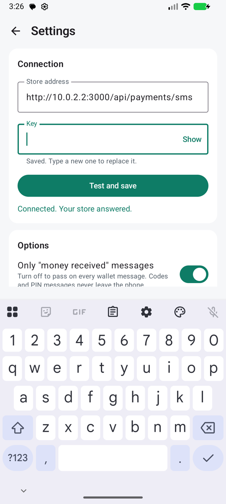
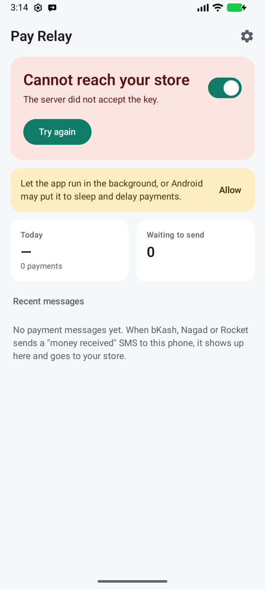

<div align="center">


# Pay Relay

**Turn the phone that holds your bKash, Nagad or Rocket SIM into an automatic payment checker for your website, shop or app.**

When someone pays you, the wallet sends your phone a "money received" SMS. Pay Relay passes that message to **your own server** within seconds. Your server reads the TrxID and amount, and confirms the order by itself. No manual checking, no payment gateway fees, no third-party SMS forwarder.

[](https://github.com/SahinurDEV/pay-relay/actions/workflows/build.yml)
[](https://github.com/SahinurDEV/pay-relay/releases/latest)
[](LICENSE)


**[Download the APK](https://github.com/SahinurDEV/pay-relay/releases/latest)** · [Quick start](#quick-start) · [Connect your server](docs/SERVER.md) · [Phone settings](#keep-it-running) · [FAQ](#faq) · [বাংলা](#বাংলায়)





</div>

---

## Who is it for

Anyone in Bangladesh who takes payments to a **personal or merchant bKash, Nagad or Rocket number** and wants them confirmed automatically:

- online shops and digital stores (licences, gift cards, subscriptions, courses)
- ticketing, event registration, membership and donation pages
- Telegram/WhatsApp bots, SaaS top-ups, game credits
- any app where the customer types the TrxID after paying

You need a server you control that can receive one HTTPS request. [docs/SERVER.md](docs/SERVER.md) has ready-to-copy code for Node.js, PHP (Laravel too) and Python.

## How it works

```
 Customer                 Your phone (Pay Relay)                       Your server
 ────────                 ──────────────────────                       ───────────
 pays Tk 1,490   ──SMS──►  "You have received Tk 1,490.00      ──HTTPS──►  POST /api/payments/sms
 enters TrxID              from 01711111111 ... TrxID CKA1B2C3D4"          saves amount + TrxID
 on your site              ✓ sender is really "bKash"                     finds the order with that TrxID
                           ✓ not an OTP / PIN message                     amount matches → order paid ✓
                           ✓ queued until the server says OK
```

The customer pays and enters the TrxID on your site. The SMS proves the money arrived. Your server matches the two. Either can come first.

## Why Pay Relay

| | Pay Relay | Generic SMS forwarder apps |
| --- | --- | --- |
| Which messages leave the phone | Only wallet payment messages | Usually every SMS, or whatever a rule matches |
| Fake payments from a normal number | Blocked: checks the real wallet sender ID | Often forwarded |
| OTP / PIN messages | Never sent | Can be forwarded by mistake |
| No internet | Queued, sent automatically later | Often lost |
| App was stopped or phone restarted | Picks up missed messages from the inbox | Lost |
| Where data goes | Only your server, over HTTPS | Sometimes the developer's cloud |
| You can see what happened | Today's total, per-payment result, alerts | Rarely |
| Source code | Open, MIT licence | Usually closed |

## Quick start

**1. Server.** Add the endpoint to your server ([examples](docs/SERVER.md)) and choose a long random key:

```bash
openssl rand -hex 32
```

**2. Phone.** On the phone with the wallet SIM, download and install [the latest APK](https://github.com/SahinurDEV/pay-relay/releases/latest). Android may ask you to allow installing from your browser or file manager.

**3. Connect.** Open Pay Relay → **Connect** → enter your endpoint, for example `https://your-site.com/api/payments/sms`, and the key → **Test and save**. The app saves only after your server accepts the key.

**4. Allow.** Tap **Allow SMS access**, then allow notifications and background running. Open **Settings → Background running** and follow the buttons there (see below).

The status card now says **Working**. Send yourself a small payment to see it arrive.

## Keep it running

Payments can arrive at any minute, so Android must let Pay Relay start and run by itself. Pay Relay restarts after a reboot and after an update, and retries anything it could not send. Most phones also need these settings once:

| Phone | What to turn on |
| --- | --- |
| **All** | Settings → Background running → **Allow background running** (battery: *Unrestricted* / *No restrictions*) |
| **Xiaomi, Redmi, POCO** | **Autostart** on (the app has a button that opens it) · Battery saver: *No restrictions* · lock the app in Recents |
| **Oppo, Realme, OnePlus** | **Auto launch** / *Allow auto-start* on · Battery: *Allow background activity* |
| **Vivo, iQOO** | **Background auto-start** on · Battery: *High background power consumption* allowed |
| **Samsung** | Battery → **Never sleeping apps** → add Pay Relay · turn off *Put unused apps to sleep* for it |
| **Huawei, Honor** | App launch → Pay Relay → *Manage manually*, all three switches on |
| **Infinix, Tecno, itel** | Phone Master → **Auto-start** on |
| **Pixel, Nothing, Motorola** | Only the battery setting above |

[dontkillmyapp.com](https://dontkillmyapp.com) has step-by-step pictures for every brand.

Also:
- Keep the phone charged and online (Wi-Fi or mobile data).
- Don't **Force stop** the app. If you did, open it once: it collects the messages it missed.
- Use the wallet phone mainly for this job, and keep a screen lock on it.

## What you see in the app

- **Status card:** *Working* with the time of the last contact, or exactly what is wrong (no SMS permission, wrong key, server unreachable) with a button to fix it.
- **Today:** the total received today and how many payments.
- **Waiting to send:** messages queued because there is no internet.
- **Each payment:** wallet, amount, payer number, TrxID, and what your server answered: *Order verified*, *Waiting for the customer's TrxID*, *Amount or wallet does not match*, *Already recorded*. Tap one for the full message and to send it again.
- **Notification** when your server stops accepting messages.

## FAQ

**Does it work with a merchant or agent number?** Yes, any number on bKash, Nagad or Rocket that receives "money received" SMS. Agent cash-in messages are not payments to you and are not sent.

**Do I need a payment gateway or merchant API?** No. The SMS from the wallet is the proof. Your server only needs to match TrxID and amount.

**Can a customer fake a payment by sending me an SMS?** Not through Pay Relay: it only accepts messages whose sender is the wallet itself (`bKash`, `NAGAD`, `16216`), which a normal phone number cannot pretend to be. Your server should still check the amount and that each TrxID is used once.

**Does it read my other messages?** It looks only at the sender name of each SMS. Anything not from a wallet is dropped right there: not stored, not logged, not sent.

**Two SIMs?** Works with both SIM slots.

**What if my server is down?** Messages stay in the queue and are retried with increasing gaps, then every 15 minutes, until the server accepts them.

**Can I use it for something else than a shop?** Yes. It is a general "wallet payment → webhook" bridge. What your server does with the message is up to you.

**Is it on the Play Store?** Not yet. Google restricts SMS permissions on the Play Store to default SMS apps, so install it from [Releases](https://github.com/SahinurDEV/pay-relay/releases/latest). Each release lists the APK's SHA-256 checksum, and the release workflow builds signed APKs from the tagged source.

## Build and contribute

```bash
git clone https://github.com/SahinurDEV/pay-relay.git
cd pay-relay
./gradlew testDebugUnitTest assembleDebug   # needs JDK 17+ and the Android SDK (API 37)
```

- **Pull requests:** GitHub Actions runs the tests, lint and a debug build for every pull request, and attaches the APK to the run so anyone can try the change.
- **Releases:** pushing a tag like `v1.2.0` makes GitHub Actions build a signed APK and attach it, with its checksum, to the release. Maintainers: see [docs/RELEASING.md](docs/RELEASING.md).
- **Code tour:** `sms/WalletFilter.kt` decides what may leave the phone (unit-tested); `sms/Relay.kt` is the queue and sending; `net/GatewayClient.kt` is the request to your server; `work/` holds the background jobs; `ui/` the Compose screens in English and Bangla.
- Test an incoming SMS on the emulator: `adb emu sms send bKash "You have received Tk 10.00 from 01700000000. Fee Tk 0.00. Balance Tk 10.00. TrxID TEST123456 at 26/11/2026 10:00"`

Read [CONTRIBUTING.md](CONTRIBUTING.md) first. New wallet formats are very welcome: open an issue with an example message, with made-up numbers. Security problems: see [SECURITY.md](SECURITY.md).

## Privacy

- SMS from any sender other than the wallets is not read past the sender name, not stored and not sent.
- Wallet messages are kept only on the phone (30 days after delivery) and sent only to the address you enter, over HTTPS.
- The key is encrypted with the phone's Android Keystore. App data is excluded from backups.
- No analytics, crash reporting or advertising code. The only network destination is your server.

## License

[MIT](LICENSE): free to use, change and share, also commercially. bKash, Nagad and Rocket are trademarks of their owners; this project is not affiliated with them.

---

## বাংলায়

**Pay Relay** আপনার bKash / Nagad / Rocket সিমওয়ালা ফোনকে ওয়েবসাইট বা অ্যাপের অটোমেটিক পেমেন্ট চেকার বানিয়ে দেয়। কেউ টাকা পাঠালে ওয়ালেট যে "টাকা পেয়েছেন" SMS দেয়, অ্যাপটি সেটা কয়েক সেকেন্ডের মধ্যে **আপনার নিজের সার্ভারে** পাঠায়। সার্ভার TrxID আর টাকার পরিমাণ মিলিয়ে অর্ডার নিজে থেকেই কনফার্ম করে। কোনো গেটওয়ে ফি বা হাতে চেক করার দরকার নেই।

**কারা ব্যবহার করতে পারবেন:** অনলাইন শপ, ডিজিটাল প্রোডাক্ট, টিকিট, রেজিস্ট্রেশন, ডোনেশন, বট বা যেকোনো অ্যাপ, যেখানে কাস্টমার bKash/Nagad/Rocket-এ টাকা পাঠিয়ে TrxID দেয়।

**নিরাপত্তা:**
- শুধু ওয়ালেটের নিজের সেন্ডার (bKash, NAGAD, 16216) থেকে আসা মেসেজ পাঠানো হয়। সাধারণ নম্বর থেকে নকল মেসেজ পাঠিয়ে পেমেন্ট দেখানো যায় না।
- OTP, PIN বা ব্যক্তিগত মেসেজ কখনো ফোনের বাইরে যায় না।
- মেসেজ শুধু আপনার দেওয়া ঠিকানায় HTTPS দিয়ে যায়। কোনো বিজ্ঞাপন বা ট্র্যাকিং নেই।

**সেটআপ:**
1. সার্ভারে endpoint যোগ করুন ([উদাহরণ কোড](docs/SERVER.md)) আর একটা লম্বা গোপন কী ঠিক করুন।
2. ওয়ালেট সিমওয়ালা ফোনে [APK](https://github.com/SahinurDEV/pay-relay/releases/latest) ইনস্টল করুন।
3. **Connect** চেপে ঠিকানা আর কী দিন → **Test and save**।
4. SMS, নোটিফিকেশন আর ব্যাকগ্রাউন্ডে চলার অনুমতি দিন। **Settings → Background running** থেকে অটো-স্টার্ট চালু করুন।

**ফোন সেটিংস (একবার করলেই হবে):** Xiaomi/Redmi-তে Autostart চালু আর Battery "No restrictions"; Oppo/Realme-তে Auto launch; Vivo-তে Background auto-start; Samsung-এ "Never sleeping apps"-এ যোগ করুন। ফোন চার্জে আর নেটে রাখুন। অ্যাপ Force stop করবেন না; করলে একবার খুললেই বাদ পড়া মেসেজ তুলে নেবে।

**নেট না থাকলে:** মেসেজ ফোনে জমা থাকে, নেট এলে নিজেই চলে যায়। সার্ভারে পৌঁছাতে না পারলে নোটিফিকেশন দেয়।
